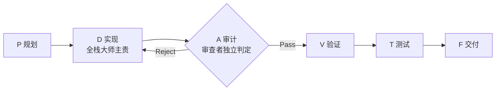

# 能力资产沉淀与演进方案（初步）

> 状态：**草案**，供讨论与后续拆分任务
> 读者：维护者
> 依据：本仓库现状 + 4 个成熟项目实测（`caomei-auth`、`caomei-ui`、`dependfix`、`momei`）
> 阶段定位：**沉淀期**——目标是让技能 / 智能体 / 规范逐步通用化，但现阶段不强求所有项目统一。

---

## 1. 背景

技能与智能体已经在多个项目中实际使用并各自演进。随着模型能力提升，一部分技能内容正在变成"复述常识"，而真正稀缺的是**项目侧契约**（阈值、门禁、路径、判定规则）与**纠偏约束**。同时暴露出一个结构性缺口：可复用的技能 / 智能体**没有配套的规范体系**——规范目前寄生在单个项目（momei）里，没有独立身份。

本方案记录讨论结论，并给出后续改动的分批计划。

---

## 2. 关键结论（讨论沉淀）

### 2.1 技能价值的判据

技能是否冗余，用两条轴判定，缺一不可：

| 轴 | 判据 | 说明 |
| :--- | :--- | :--- |
| **读者轴** | 对**执行者**无可推断信息 → 冗余；对**维护者**（重构时才读）→ 不冗余 | 解释 Why 层为何"不进执行路径但必须存在" |
| **使用轴** | 实际几乎不触发、或触发后不改变行为 → 怀疑其价值 | 价值 ≈ 触发频率 × 缺失时的代价 |

注意：**低频 ≠ 该删**。低频高代价的技能（如安全审计）必须保留；真正可疑的是"低频 × 低代价 × 对执行者无可推断信息"三者叠加者。

### 2.2 技能正在从「知识包」变成「契约包」

- 旧形态 = 知识包（装模型没有的信息）→ 随模型变强而萎缩。
- 新形态 = 契约包（阈值、门禁、产物路径、判定规则）→ 模型再强也需要，因为它是项目侧约定。

同一件事换个写法就决定其是冗余还是资产。例："先搜索"是操作提醒（冗余）；"同一问题修复失败 ≥ 2 次触发搜索优先流程，≥ 3 次停止并请求人类介入"是阈值契约（资产）。

**方向是瘦身，不必然是删除**：榨掉通用叙述，只留契约与不可推断事实。

### 2.3 规范的三层收敛度（4 项目实测）

| 层 | 实测结论 | 是否上移 |
| :--- | :--- | :--- |
| **概念层** | PDTFC+、验证分级矩阵、Review Gate、搜索优先 **4/4 全中** | ✅ 直接上移 |
| **章节层** | 按"出现在 ≥3 项目的同名章节"排序：`security`（6 章）> `ai-governance`（2）≈ `ai-collaboration`（2）> `git`（1）> `development`（1）> `testing`（0）≈ `documentation`（0） | 🟡 章节级上移 |
| **正文层** | 同主题正文行数差 3–10 倍（如 `development.md` 71 vs 597 行） | ❌ 永不上移，项目自持 |

**结论**：共同出现 ≠ 该上移；判据是**收敛度**而非**是否存在**。上移粒度是「概念 / 章节」，不是「文件」。

### 2.4 核心不变核：生成 / 检验博弈

跨「本仓库 + 4 项目」实测，收敛度最高的不是任何规范文件，而是这条工作流协议：

其中 `P / D / A / V / T / F` 六阶段名在「本仓库、caomei-auth、dependfix、momei」中**逐字一致**。

`code-reviewer` 的不变核在 5 处**零例外**全中：最低验证矩阵、audit-depth 分级、Review Gate 结论、Findings 三级分级（blocker / warning / suggest）、验证证据、技能文件专项审查。

**设计哲学**：这套核的第一性原理是**生成者与检验者分离**。它解释了全部细节设计：

| 设计 | 由"生成 / 检验分离"解释 |
| :--- | :--- |
| 审查者需独立 agent / 独立上下文 | 检验者不能与生成者共脑 |
| 禁止自我审查替代 | 分离是硬约束，不是建议 |
| audit-depth | 博弈强度可调 |
| Findings 分级 | 裁决口径（哪些回炉、哪些放行） |
| 验证矩阵缺失即 Reject | 检验有最低证据门槛 |

**推论**：`full-stack-master` 与 `code-reviewer` 不是两个孤立技能，是**同一博弈协议的两个角色**。

### 2.5 规范上游现状与缺口

| 资产 | 上游载体 | 状态 |
| :--- | :--- | :--- |
| 技能 / 智能体 | 本仓库 | ✅ 已有 canonical |
| 规范 | **寄生在 momei**（dependfix `docs/standards/index.md` 明写"1.0.0 前参考 momei 完成独立化"） | ❌ 无独立身份 |

**两个上游并存、未合流。** 而 Review Gate 协议同时是技能内容与规范内容，是两者天然的**第一个合流点**。

### 2.6 已实测但未被采用的机制

- **`.ai` 覆盖层：0/4 项目采用。** 实际做法是「整份 fork 到 `.github/skills` + `docs/standards/index.md` + `AGENTS.md` 单点权威」。
- 结论：`.ai` 覆盖层对"规范"场景过重，现阶段**不推广**；规范覆盖用 `index.md` 一层即可。

### 2.7 记忆层与技能 / 规范同构

"库 / 实例 / 沉淀"结构在三处重复出现：

| 资产 | 库 | 实例 | 沉淀 |
| :--- | :--- | :--- | :--- |
| 技能 | 本仓库 | 项目 `.github/skills` | 回贡上游（当前靠人工） |
| 规范 | 待定义 | 项目 `docs/standards/*` | 章节级上移 |
| 记忆 | `mem0`（跨项目通用） | `.session/wisdom.md`（3/4 项目已采用） | ≥20 条触发蒸馏 |

推论：`mem0` 的正确定位是**跨项目通用层**，项目记忆交给 `.session/`。

---

## 3. 改动计划（分批）

### 批次 A：Why 层补齐（P0）

- **对象**：7 个 L0 技能（`context-analyzer`、`requirement-analyst`、`technical-architect`、`quality-guardian`、`security-guardian`、`conventional-committer`、`git-flow-manager`）+ 3 个活跃 agent（`skill-agent-governor`、`product-manager`、`ui-validator`）。
- **动作**：按 [rationale-template.md](../skills/skill-creator/references/rationale-template.md) 编写，必须含 §5「能力替代 vs 不可推断」与 §6「项目覆盖锚点」。
- **附带产出**：各技能 §6 的锚点表汇总为规范索引初稿。
- **判据**：每个技能都能回答"什么条件下应删除或合并"。

### 批次 B：核心协议抽取

- **目标**：把「PDTFC+ 六阶段 + Review Gate 协议」抽为单点权威，技能只引用、不复述。
- **决策点**：是否将 Review Gate 协议作为第一个"上游规范"。
- **前置**：批次 A 的两份既有 Why（`full-stack-master`、`code-reviewer`）可作为范式。

### 批次 C：规范体系地基

- **C1 别名映射表**：登记同义不同名的技能 / 规范（如 `code-quality-auditor ↔ code-reviewer`、`backend-logic-expert ↔ backend-expert`）。这是自动 diff 的前置。
- **C2 沉淀探针**：基于播种快照基线做 drift 检测，输出"该上移 / 该留项目"候选。必须与**播种时基线**比对，而非最新上游。
- **C3 规范骨架模板**：按概念层 / 章节层从 momei 抽取，正文留项目。
- **判据**：概念层 ≥3/4 → 上移；章节层 ≥3/4 同名 → 上移；其余留项目。

### 批次 D：初始化技能

- **形态**：一次性**全局元技能**（不进项目），仅在首次安装时执行。
- **动作**：物化 seed 技能 + 生成规范骨架并链入 `AGENTS.md` + 初始化记忆文件。
- **幂等策略**：仅在缺失时创建；已存在则 diff 提示、不覆盖。

### 批次 E：记忆层收敛

- 明确 `.session/` 为项目记忆默认载体；`mem0` 退居跨项目通用层。
- 沿用既有"≥20 条触发蒸馏"机制。

---

## 4. 暂缓 / 否决项

| 项 | 决定 | 理由 |
| :--- | :--- | :--- |
| 强推所有项目统一使用同一套技能 / 规范 | 暂缓 | 处于沉淀期，先复用成熟项目经验 |
| 推广 `.ai` 覆盖层 | 暂缓 | 0/4 采用，对规范场景过重 |
| 全量 standards 正文上移 | 否决 | 正文层发散（差 3–10 倍），只能上移概念 / 章节 |

---

## 5. 待决问题

1. Review Gate 协议是否抽为独立的上游规范，让技能只引用？
2. 上游 `code-reviewer` 结构是否向"B 代 7 步工作流"（`dependfix` / `momei` 形态）收敛？
3. 别名映射表是人工维护还是半自动生成？
4. 初始化技能的幂等策略（缺失才建 / diff 提示）是否确认？
5. 规范上游落点：新建本仓库 `standards/`，还是沿用 momei 为基线？

---

## 6. 验收 / 回测方式

- **收敛判据回测**：用 4 个项目的实测章节交集，验证"概念层 ≥3/4 / 章节层 ≥3/4"判据的命中率。
- **Why 层验收**：每个补齐对象都能回答"何时删除或合并"。
- **协议单点化验收**：抽取后，技能正文不再复述协议细节，只保留引用与项目侧差异。

---

## 7. 参考

- [下游项目迁移参考方案](./downstream-migration.md)
- [项目覆盖层约定](../skills/skill-creator/references/project-overlay.md)
- [Why 层模板](../skills/skill-creator/references/rationale-template.md)
- [通用开发规范参考](../skills/full-stack-master/references/standards-reference.md)
